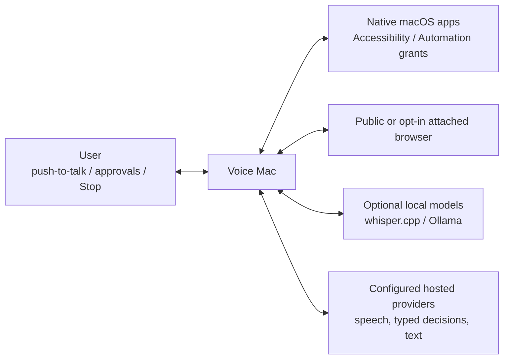
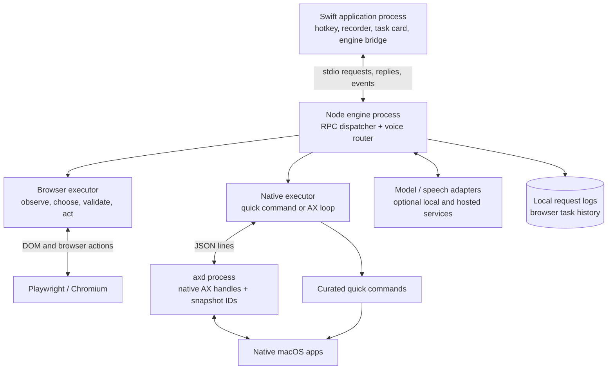
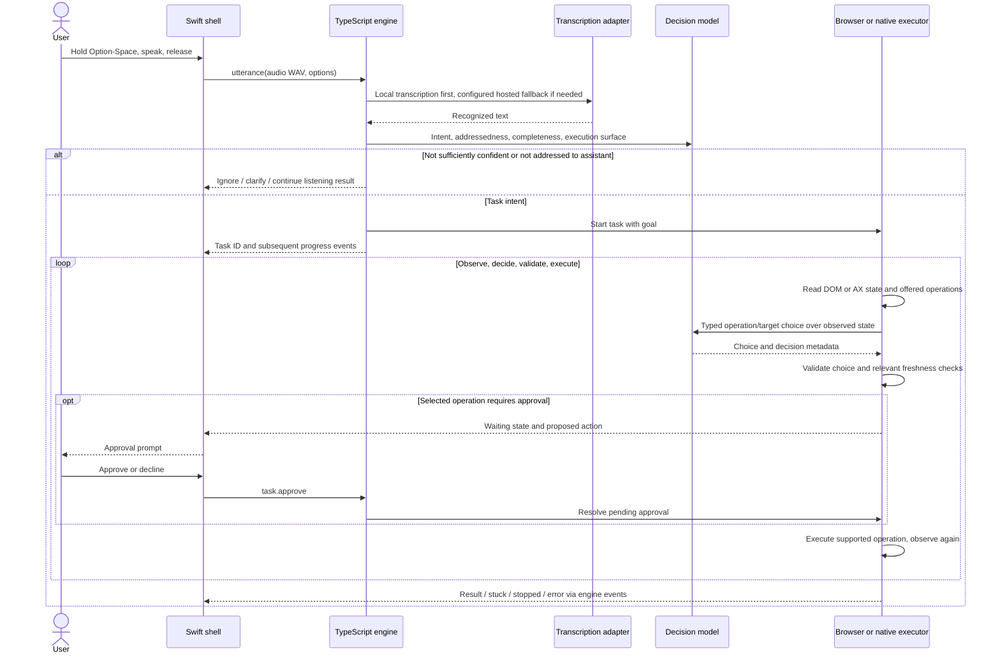
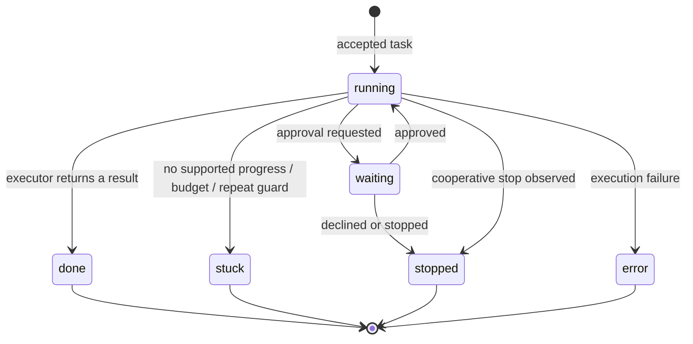
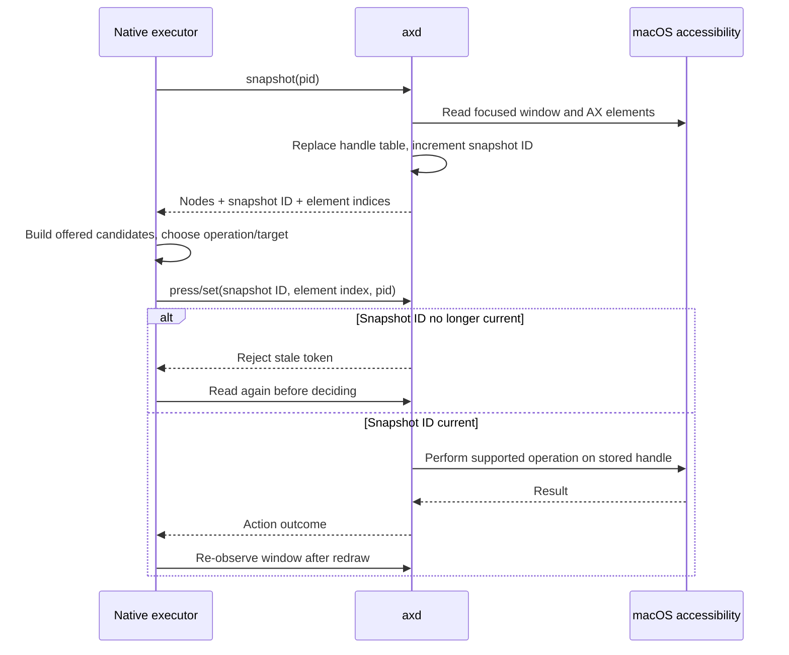
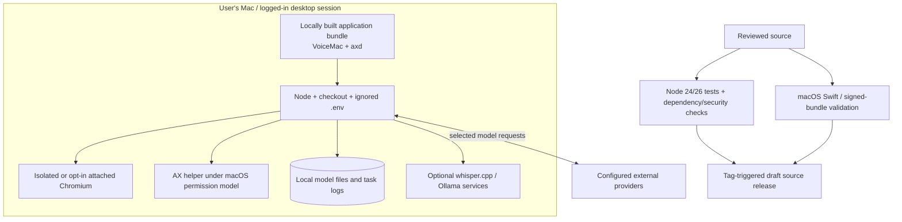

# Voice Mac architecture

**Keep native interaction close to macOS, while making the automation decisions inspectable in a separate engine.**

Voice Mac is an experimental desktop assistant: a Swift menu-bar shell captures short requests, a TypeScript
engine selects and executes actions, and a Swift accessibility helper operates native controls. Browser tasks
use Playwright and observed DOM actions.

This guide describes the current implementation and analyzes its tradeoffs. It is not a record of comparative
benchmarks or a claim of general-purpose autonomous safety. [Setup](README.md) ·
[Exact protocol and configuration](docs/architecture.md) · [Demo and validation limits](docs/demo.md).

## 1. Design goals and constraints

| Goal | Implemented mechanism | Cost / boundary |
| --- | --- | --- |
| Native interaction | SwiftUI/AppKit/Carbon shell and AX helper | macOS permissions, signing identity, and SDK coupling |
| Inspectable automation | Typed choices, step traces, progress events, explicit task states | Model choices remain fallible and require separate validation |
| Responsive voice front door | Push-to-talk capture and transcription/router adapters | Speech and model calls can dominate perceived latency |
| Narrow execution vocabulary | Observed DOM/AX targets and curated native quick commands | Unsupported controls and apps can leave a task stuck |
| Local process integration | Newline-delimited request/reply and event messages over stdio | Child-process lifecycle and protocol robustness become product concerns |
| Reproducible development | Offline checks and independent Swift build | Offline success does not measure live voice/task accuracy |

## 2. Context and external boundaries

The executable and model providers are different trust boundaries. An on-device shell does not imply that all
processing is local. Hosted adapters can receive audio, task text, observed page/window context, or generated-text
requests depending on the selected path. Attaching a signed-in browser adds access to that session's authority.

## 3. Process architecture and ownership

The shell owns presentation, recording, and its engine child. The engine owns task execution and progress.
`axd` owns native element handles; JavaScript receives serializable observations and snapshot-scoped tokens,
not raw pointers. The current native executor uses `axd`; the separate Cua adapter is not evidence of an
automatic failover path for every native action.

[Shell](shell/Sources/VoiceMac/) · [RPC dispatcher](engine/rpc.ts) · [Browser executor](engine/browser.ts) ·
[Native executor](engine/mac.ts) · [AX client](engine/lib/ax.ts) · [AX implementation](shell/Sources/axd/main.swift).

## 4. A voice request through to an observed result

This is a conceptual path, not a promise that every executor performs the exact same checks. Native quick
commands can finish without the full observation loop. A Stop request is cooperative: it changes task state and
releases a pending approval; it does not undo an action already executed or instantly abort every provider call.

## 5. Task lifecycle and state ownership

Task maps are in memory. Browser task summaries can be written to local history; native task history is not the
same durable interface. Browser and native executors each check their own active-task map. There is **no global
cross-executor scheduler** or persistent job queue, so direct API callers must not assume process-wide single-task
serialization or restart/resume semantics. The voice router selects an active task for stop/approval routing,
but that selection is not a transaction lock across all task methods.

## 6. Freshness and target identity

Snapshot identity protects against reusing an index from a replaced helper snapshot. It does not prove that a
window's meaning stayed unchanged while a model request was in flight. The browser has its own fingerprints,
freshness checks, and post-action observation. Its handling of highly dynamic pages deliberately relaxes some
freshness checks after repeated stale cycles; the code is more nuanced than “every action always uses a fresh
page.” [Browser observation logic](engine/browser.ts) · [Snapshot checks](shell/Sources/axd/main.swift).

## System-design reasoning: structural validity is not semantic authorization

This prototype prioritizes a native interaction experience, an inspectable action loop, and a practical development
boundary between Swift and the JavaScript ecosystem. It does **not** establish the stronger requirements of an
unattended agent operating consequential authenticated workflows. That distinction changes the architecture,
not merely the wording of a prompt.

### Latency is a dependency graph, not a UI-animation problem

A planning decomposition is `transcription + routing + sum(observe + decide + act + settle)` over the executed
steps, plus any text generation and user approval waits. The values must come from traces of a representative
workload. Faster AX operations do not remove speech/model/network time; parallelizing speculative decision heads
reduces some round trips but still consumes context/tokens and can offer irrelevant targets.

The quick-command path removes repeated observation/decision steps for a narrow operation catalog. The general
loop buys broader coverage at higher latency and a larger failure surface. That is a conscious coverage/latency
tradeoff, not evidence that one route is universally faster or safer. A high model confidence is also not a
measured end-to-end success probability without a calibration dataset.

### Two process boundaries, two different purposes

Swift-to-Node is an integration/lifecycle boundary. Node-to-`axd` is a native-handle/implementation boundary.
All can run with the logged-in user's authority. Separating them improves testability and fault diagnosis; it
does not create a privilege sandbox. DOM/AX content remains untrusted data, and an allowed operation vocabulary
can still be used to perform the wrong allowed action.

| Layer | What it checks or controls | What it does not prove |
| --- | --- | --- |
| Typed choice validation | An answer names an offered operation/target with a structurally valid distribution | The target is semantically right for the user's goal |
| Snapshot/freshness logic | Some stale references and changed page states are detected | Read/decide/act is not atomic with respect to the UI |
| Risk prompt / quick-command risk flag | Selected actions wait for user approval | Every consequential action is classified, or that approval remains valid after state changes |
| Requirement assessments / completion handling | Model-reported gaps can affect progress and be surfaced | An independent deterministic postcondition has been established for every goal |
| Action/repeat budgets | Some loops and repeated no-progress behavior are bounded | Previous actions can be rolled back or later effects prevented instantly |

### Crash recovery is harder than putting tasks in a database

If the engine crashes after clicking Send but before recording success, replaying the queued step can send a
second message. A durable queue only preserves intent; it does not tell whether the external application
committed the effect. Resumption would need application-specific postcondition checks, idempotent APIs where
available, or a human-visible uncertain outcome. This is the same class of boundary that ZeroSum models for a
payment provider, but arbitrary desktop UIs often expose a weaker operation contract.

Browser and native executors also lack a shared global scheduler. Expanding concurrency would require defining
ownership of focus, windows, browser sessions, approval state, and Stop semantics. More parallel model calls
without that ownership model can make correct individual actions interfere with one another.

| Stronger requirement | Current limitation | Change to evaluate |
| --- | --- | --- |
| Audio and context must never leave the Mac | Local-first adapters can fall back to hosted services; decisions can use hosted models | Explicit enforceable routing policy and local-only model paths, with tests that reject external requests |
| Consequential unattended authenticated tasks | Heuristic risk/requirement assessments are insufficient authorization | Deterministic capabilities, approval binding/expiry, scoped sessions, and independently checked postconditions |
| Restart safely after any action | In-memory tasks and uncertain external UI effects | Checkpointed intent plus effect reconciliation/idempotency; do not blindly replay |
| Multiple simultaneous clients/tasks | Focus and task authority are not globally coordinated | A scheduler, task ownership, backpressure, and a versioned client/session contract |
| Standalone app distribution | Bundle embeds a checkout and local Node path | Bundled runtime/assets, signing/notarization, upgrade strategy, and permission-migration testing |

## 7. Decisions and tradeoffs

### D1 — Swift shell plus TypeScript engine instead of one runtime everywhere

**Chosen:** Swift handles native UI, hotkeys, microphone capture, and system APIs. TypeScript hosts provider SDKs,
Playwright, orchestration, and step traces. The process boundary lets offline engine checks run separately from
the GUI and gives the shell an explicit progress/error contract.

**Alternatives:** an all-Swift implementation reduces runtime packaging but requires more work around browser
and model integrations. An Electron-only shell consolidates JavaScript while still needing native helpers for
some macOS behavior, and adds a different desktop runtime. A cloud orchestrator would simplify centralized
execution but cannot directly own the user's native accessibility session.

**Cost / revisit:** distribution now includes Swift binaries, Node, package dependencies, and a checkout. The
bundle stores local paths and is not a portable installer. Revisit packaging when shipping a standalone app;
keep the process contract even if the engine runtime is bundled differently.
[Build script](shell/build.sh) · [Shell bridge](shell/Sources/VoiceMac/Engine.swift).

### D2 — Stdio protocol instead of a local HTTP service

**Chosen:** the parent shell launches the engine and exchanges newline-delimited objects with request IDs,
results/errors, and task events. There is no listening engine HTTP port to discover or authenticate. Stdout
is the protocol channel, and closing stdin terminates the engine process.

**Alternatives:** HTTP/WebSocket makes multiple clients and reconnection easier, but needs port/lifecycle,
authentication, and origin policy decisions. In-process integration avoids serialization but ties languages
and failure handling together more tightly.

**Cost / revisit:** request correlation, malformed input, interleaved events, and child failure need explicit
handling. This is a small JSON-RPC-inspired protocol, not full JSON-RPC 2.0: no batch/version/error-code
compatibility is promised. It is not an OS security sandbox. Add a versioned transport/authentication contract
before supporting unrelated clients or remote control.
[Protocol](docs/architecture.md#protocol) · [Dispatcher](engine/rpc.ts) · [Subprocess regression test](tests/rpc.test.mjs).

### D3 — Typed observed choices instead of arbitrary model-generated scripts

**Chosen:** the model selects an operation and offered target, with choice/distribution validation before the
supported action executes. Native quick commands come from a curated catalog whose implementations are code;
the model fills structured arguments rather than generating an unrestricted program.

**Alternatives:** free-form shell or browser scripts offer a larger action space but make intent, target binding,
review, and testing harder. Screenshot-coordinate control can reach controls without semantic metadata but is
sensitive to layout, focus, and scaling. DOM/AX observations provide labels and roles that can constrain choices.

**Cost / revisit:** inaccessible controls, canvas content, unlabeled fields, stale state, and wrong model choices
still exist. Typed validation checks response structure, not semantic correctness; a numeric confidence is not
proof of calibrated success or authorization. Add another executor only with an explicit action model and tests.
[Choice validation and action space](engine/browser.ts) · [Quick catalog](engine/quick.ts).

### D4 — Native quick commands first, AX loop for general interaction

**Chosen:** common operations use a finite command catalog; other native goals can fall through to the
observe/choose/act loop over `axd`. A persistent helper avoids rebuilding native element state through a new
external driver process for every action.

**Alternatives:** making every request a UI loop is more uniform but adds model decisions for predictable
operations. Building a bespoke integration for every app gives precise semantics but expands the maintenance
surface. AX offers a shared interface where applications expose it, rather than a universal guarantee.

**Cost / revisit:** quick-command success reporting can rely on command output rather than the full observed-loop
verification. The catalog needs app-specific maintenance and argument/security review. `axd` also introduces
snapshot lifetime, helper timeout, and child-exit handling. Revisit the split using measured traces of the actual
slow/failing paths, not an assumed latency advantage for every command.
[Native routing](engine/mac.ts) · [Helper client](engine/lib/ax.ts) · [Helper source](shell/Sources/axd/main.swift).

### D5 — Local-first transcription with explicit provider adapters

**Chosen:** local whisper.cpp is attempted when configured, with hosted transcription available as a fallback.
Typed action decisions and generative field/text writing use different adapters. This keeps task-control output
separate from open-ended text generation and makes optional local text generation possible through Ollama.

**Alternatives:** cloud-only speech reduces local model setup but makes connectivity and provider handling
central to every request. Fully local processing can reduce external data exposure but introduces model
availability, hardware, quality, and latency constraints. One model for every operation simplifies integration
while mixing structured control and generation workloads.

**Cost / revisit:** fallback order differs by operation, credentials can fail independently, and a local-first
path can still send data off-device. There is no global privacy mode that proves all adapters stay local.
Revisit provider selection with reproducible speech/task datasets and explicit data-routing controls.
[Speech/text adapters](engine/lib/llm.ts) · [Typed client and tracing](engine/lib/jev.ts).

### D6 — Approval gates and budgets are layers of control, not a sandbox

**Chosen:** selected browser clicks and native operations can enter `waiting` and require approval. The quick
catalog marks risky operations explicitly; other risk decisions use model output. Repeat/progress guards and
step/model-call budgets limit unproductive execution.

**Alternatives:** no approval makes demonstrations shorter but increases the consequences of a wrong action.
Approval on every observation would interrupt even low-impact steps. A fully deterministic policy engine and
capability sandbox could support stronger guarantees, but they are not implemented by the current heuristics.

**Cost / revisit:** a risk model can miss an action, earlier actions are not rolled back on decline, and successful
termination is not independently certified. Browser completion retries once for unmet requirements and may then
return an answer with an explicit gap note; “done” does not mean every requirement was deterministically proven.
Revisit authorization and postcondition checks before using this for consequential unattended workflows.
[Browser loop](engine/browser.ts) · [Native approvals](engine/mac.ts).

### D7 — Isolated browser by default; personal-browser attachment is opt-in

**Chosen:** the executor can use an isolated Playwright browser. An explicit attachment option uses Chromium
remote debugging to access an existing browser and its state. This supports tasks that need a user's session
without making attachment an invisible default.

**Alternatives:** always attach avoids repeated sign-ins but broadens every task's authority. Always isolate
reduces session exposure but cannot complete every authenticated workflow. A remote hosted browser introduces
another session/storage boundary and still does not operate native Mac applications.

**Cost / revisit:** attachment exposes the signed-in session to the executor; origin/navigation checks are not a
complete defense against malicious page content. Remote-debugging setup is browser-specific. Revisit session
permission scope and deterministic policy before expanding authenticated task coverage.
[Browser creation / attachment / URL policy](engine/browser.ts) · [Offline policy checks](engine/browser.check.ts).

### D8 — Inspectable local traces, with limited persistence

**Chosen:** task progress records operations, targets, reasons, timing, and selected model-call metadata. Browser
summaries and request logs can be inspected after execution. Offline tests exercise pure action/policy logic and
the actual child-process transport without requiring a personal browser or provider key.

**Alternatives:** opaque “success/failure” logs are easier to store but hard to debug. Persisting every screenshot,
provider payload, and event durably enables deeper replay at a higher privacy/storage cost. A real workflow
database would add restart/resume and retention controls, with a substantially different product scope.

**Cost / revisit:** local logs can contain task text, URLs, and sensitive context; there is no automatic universal
redaction/retention guarantee. In-memory tasks cannot resume after a crash. Browser history is not complete native
history, and a saved step trace is not proof that replaying it would be safe. Revisit persistence when reliable
resumption or multi-client use becomes an actual requirement.
[RPC logging](engine/rpc.ts) · [Browser history](engine/browser.ts) · [Demo capture](scripts/record-demo.py).

## 8. Runtime and failure boundaries

The delivery portion is conceptual: PR checks validate both domains, while the release workflow separately
reruns engine checks and Swift compilation. There is no automatic notarized-app distribution path. Signing a
local bundle is not equivalent to notarization, portability, or stable permission identity after every rebuild.

| Failure / limit | Current behavior | Practical boundary |
| --- | --- | --- |
| Malformed stdio input | Error reply; valid subsequent requests remain usable | Not full JSON-RPC protocol compatibility |
| AX helper exits or times out | Pending helper requests reject; later use can restart the helper | No durable recovery of an in-flight UI action |
| AX token stale | Helper refuses it; native loop re-observes | Snapshot ID is not semantic authorization |
| Page changes during a decision | Browser freshness/retry logic; bounded handling of repeated stale cycles | Dynamic-page behavior is heuristic, not atomic read-and-act |
| Provider or transcription unavailable | Configured fallbacks or surfaced failure | No guarantee that an offline model is installed |
| Repeated no-progress actions / budget exceeded | Task can become stuck or error | Guards bound attempts rather than certify correctness |
| User presses Stop | Cooperative stop and release of pending approval | Prior actions remain applied; some work may finish before stop is observed |
| Engine/shell crashes | In-memory task execution is lost | No durable queue, global scheduler, or resume contract |

## 9. Evidence and a useful review path

1. Read [the shell bridge](shell/Sources/VoiceMac/Engine.swift) beside the process diagram: who creates the child,
   correlates responses, and handles termination?
2. Follow [the dispatcher](engine/rpc.ts) into [browser](engine/browser.ts) or [native](engine/mac.ts) execution.
3. Inspect [AX token validation](shell/Sources/axd/main.swift), browser choice validation, and completion handling;
   distinguish enforced checks from model-provided assessments.
4. Run [offline checks](engine/browser.check.ts) and [the real transport test](tests/rpc.test.mjs).
5. Review [CI](.github/workflows/ci.yml) and [the demo's stated limits](docs/demo.md). Live end-to-end voice accuracy,
   arbitrary-site task success, and unattended-action safety have not been established by those offline tests.

A useful design discussion is: **what would change before this could safely execute an unattended authenticated
workflow?** Stronger deterministic authorization, reliable postcondition verification, scoped session access,
redaction/retention controls, and restart semantics would be separate engineering work, not a larger prompt.

Upstream attribution and the unresolved repository license/provenance decision remain documented in
[the implementation guide](docs/architecture.md#provenance-and-licensing).
