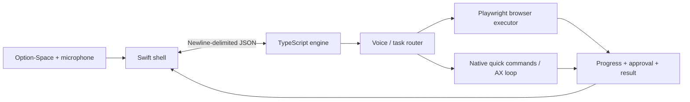

<div align="center">

# Voice Mac

**One voice entry point for the browser and native macOS apps.**

A Swift menu-bar shell and a TypeScript automation engine that turn short spoken requests into typed
actions, read the result, and expose progress and approvals over a local stdio protocol.

[](https://github.com/ai-calypse/voice-mac/actions/workflows/ci.yml)
[](https://github.com/ai-calypse/voice-mac/actions/workflows/codeql.yml)

[Architecture & tradeoffs](ARCHITECTURE.md) · [Protocol](docs/architecture.md) · [Demo](docs/demo.md) · [Contributing](CONTRIBUTING.md)

</div>

**Status: experimental macOS prototype.** Browser execution, a push-to-talk shell, native quick commands,
and an accessibility-driven action loop are implemented. Native-app coverage is still evolving. Taught
routines and meeting notes are future directions, not completed features.

## Engineering at a glance

| Layer | Responsibility | Code |
| --- | --- | --- |
| Swift shell | Option-Space hotkey, microphone capture, notch UI, approvals | [VoiceMac](shell/Sources/VoiceMac/) |
| Stdio engine | Request dispatch, task events, cancellation, local logs | [RPC](engine/rpc.ts) |
| Browser executor | DOM action space, action validation, progress, risk prompts | [Browser](engine/browser.ts) |
| Native executor | Curated quick commands and accessibility action loop | [Mac](engine/mac.ts) · [Quick commands](engine/quick.ts) |
| Accessibility helper | In-process AX reads and actions over a child process | [axd](shell/Sources/axd/) |
| Model adapters | Typed decisions, text generation, local/hosted transcription | [Adapters](engine/lib/) |




## Start with the offline checks

Requires Node.js 24+ and npm. These checks need no API key, microphone, browser login, or macOS permission.

```sh
git clone https://github.com/ai-calypse/voice-mac.git
cd voice-mac
npm ci
npm run typecheck
npm test
```

Try the real engine transport without calling a model:

```sh
node engine/rpc.ts
# After the ready event, enter:
{"id":1,"method":"ping"}
# Response: {"id":1,"result":{"ok":true}}
```

The transport is a small newline-delimited request/response protocol, inspired by JSON-RPC. It does not
implement the complete JSON-RPC 2.0 specification. [Methods, events, and examples](docs/architecture.md).

## Run the macOS app

Requires macOS 14+, Xcode Command Line Tools / Swift 5.10+, and the same checkout with Node on your PATH.
The app bundle records the checkout and Node paths and must be rebuilt if they move.

```sh
cp .env.example .env
# Set TYPESAFE_API_KEY for action selection; configure speech/text providers as needed.
npm exec playwright install chromium
./shell/build.sh
open 'shell/dist/Voice Mac.app'
```

Hold **Option-Space** to speak. Grant Microphone and Accessibility permissions when macOS asks. The build
uses an Apple Development signing identity when available, or ad-hoc signing for local development;
ad-hoc rebuilds may need permission grants again. No notarized, standalone installer is provided.

| Configuration | Used for |
| --- | --- |
| `TYPESAFE_API_KEY` | Typed Jev decisions for routing and action selection |
| `GROQ_API_KEY` | Hosted transcription fallback and structured text |
| `GEMINI_API_KEY` | Optional text generation and document/image transcription |
| `WHISPER_MODEL` | Local whisper.cpp model path; `whisper-server` must be on PATH |
| `OLLAMA_URL`, `LOCAL_TEXT_MODEL` | Optional local text generation |
| Local Claude authentication | Optional Agent SDK text-generation fallback |

For browser tasks, start with the isolated browser. Attaching your existing Chromium browser is opt-in via
“Use my Brave” and requires remote debugging to be enabled in that browser. See [setup and trust boundaries](docs/architecture.md#configuration-and-trust-boundaries).

## Quality and delivery

CI checks TypeScript and offline behavior on Node 24 and 26, audits dependencies, builds and verifies the
Swift app bundle on macOS, validates workflow/documentation changes, and runs CodeQL on JavaScript/TypeScript
and Actions. Version tags produce a draft **source release** after engine checks and a Swift build. They do
not publish a portable app bundle, because the current bundle depends on local checkout paths.
[Maintenance process](docs/maintaining.md).

## Current limits and attribution

Approval gates cover selected risky actions; they are not a sandbox or a guarantee that every action is
safe. Attached browsers expose signed-in sessions to automation. Local task logs can contain text and URLs;
transcription and model providers may receive audio, page state, or task text depending on configuration.

The original implementation credits Jev Lab / browser-use's Jev work for browser logic, Aloud for curated
AppleScript, and Computah for accessibility-helper ideas. [Provenance notes](docs/architecture.md#provenance-and-licensing).
The repository currently has no license grant; redistribution needs a provenance and licensing review.

[Contributing](CONTRIBUTING.md) · [Security policy](SECURITY.md)
