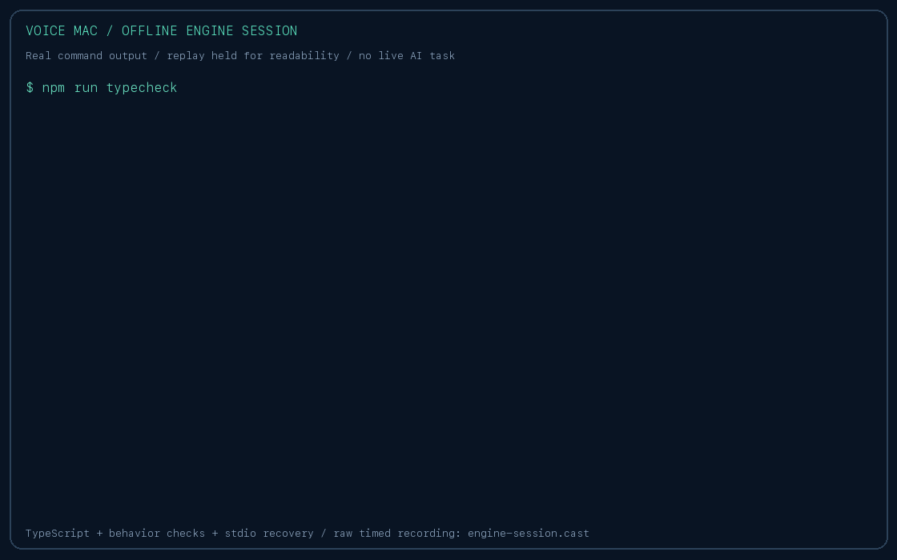

# Demo: start with an inspectable local engine

## Offline transport demo



This replay shows real command output, held longer for readability. The [raw timed session](demos/engine-session.cast)
uses asciinema v2 format. Regenerate it with `python3 scripts/record-demo.py` from the checkout; it runs only
offline checks and local transport requests. It is not a live voice or browser-task recording.


```sh
npm ci
npm run typecheck
npm test
node engine/rpc.ts
```

After the ready event, enter `{"id":1,"method":"ping"}` and inspect the `ok` response. Send malformed input,
then another ping to demonstrate that the process recovers. The automated RPC test uses the actual child process
and also rejects inherited object-method names. None of these checks call a provider.

## Live macOS demo

Follow the README to configure providers, install Chromium, build the shell, and grant macOS permissions.
Use an isolated browser, public pages, and a harmless goal such as looking up a public documentation page.
Show the request, observed steps, a result, and Stop. Approval prompts should be demonstrated with a disposable
example, not a real purchase or message. Do not attach personal accounts for a public recording.

A live end-to-end voice recording is not included: fresh-checkout validation used offline checks and Swift
compilation without personal microphone/browser grants or provider credentials. This guide is a reproducible
capture plan, not evidence that those live steps have been verified here.

[Architecture, protocol, and validation limits](architecture.md).
